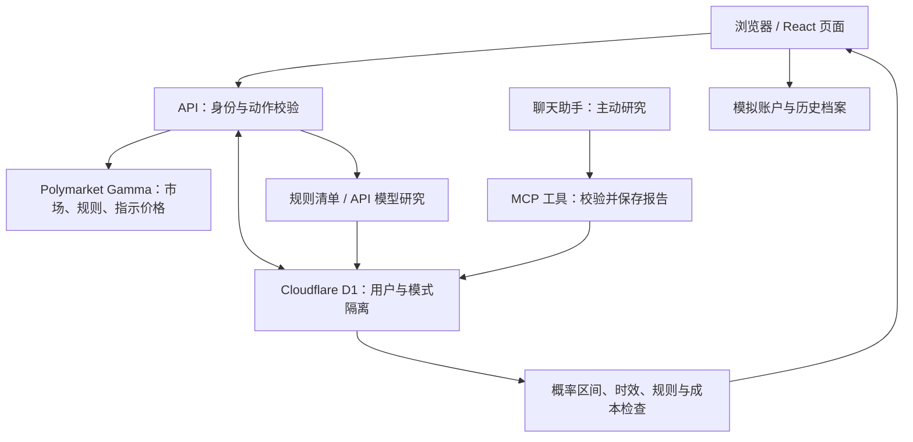

# 事件镜内部结构与判断逻辑

## 一句话结构

浏览器负责展示和触发任务；服务器负责验证身份、拉取数据、调用模型、计算与保存；D1 保存个人研究状态。技能文件是研究方法说明，不是自动执行的金融模型。

## 源码地图

| 位置 | 用途 |
|---|---|
| app/page.tsx | 总览、关注、提醒、档案、模拟账户、设置与详情抽屉 |
| app/research-lab.tsx | 模型控制、候选列表、策略说明 |
| app/guide/page.tsx | 内置使用手册 |
| app/chat-research/page.tsx | 聊天研究连接与操作说明 |
| app/globals.css | 响应式布局与界面样式 |
| app/api/workspace、action、ai-status | 读取工作区、执行动作、查询模型可用状态 |
| lib/workspace.ts | 工作区读写、动作分发、并发版本检查 |
| lib/markets.ts | Gamma 拉取、二元市场归一化、快照合并 |
| lib/research.ts | 不调用模型的规则研究清单 |
| lib/ai-research.ts、ai-config.ts | 模型请求、来源约束、结构校验、额度和配置 |
| lib/chat-report.ts、app/mcp/route.ts | 聊天工具接口与报告保存校验 |
| lib/opportunities.ts | 分析到期判断、候选情景计算与阻断 |
| lib/paper.ts | 模拟现金、持仓与费用 |
| lib/types.ts、lib/demo.ts | 数据类型与明确标注的虚构示例 |
| db、drizzle | D1 数据结构与初始迁移 |
| scripts/start-local.mjs | 本地启动、依赖检查与非破坏性建表 |
| .openai/hosting.json、vite.config.ts | Sites 身份、云资源绑定与构建配置 |

## 数据如何进入系统

Gamma 按 24 小时成交量拉取最多 60 条活跃未关闭市场，再筛选 YES/NO 二元市场；也支持手动添加具体市场。它不是全市场覆盖，也没有全网自动新闻抓取。历史曲线来自程序实际采集的价格快照，不代表完整交易历史。

刷新后更新规则哈希与价格，关注市场达到累计价格变化阈值（默认 5 个百分点）或发生规则变化时形成站内提醒。失败或未覆盖的旧市场可能仍保留，必须检查单个市场更新时间。

D1 的 research_preferences 保存默认模式；research_workspaces 按用户和 demo/live 模式保存 JSON 工作区及 revision。并发写入通过版本比较防止覆盖。单工作区有大小和数量限制，例如 150 个市场、20 个关注，每市场最多 100 份报告；不是无限历史档案库。

## 三种研究路径

1. **规则清单**：整理规则、材料与缺口，不会凭空生成专业概率。
2. **API 模型研究**：服务端调用模型并使用网页搜索；分析输入不先灌入市场价格，以减少价格锚定。检查返回结构、来源链接与搜索结果的对应、时间、正反证据、概率区间等；不足则弃权。格式和来源匹配检查不能保证事实正确。
3. **聊天研究**：外部助手检索并调用保存工具。接口检查格式、时间、规则一致性，并标明聊天来源；本站不会重新检索并证实每条事实。

报告保留结算规则快照、正反论据、基准率、信息缺口、来源、时间、推翻判断条件及主观概率区间。区间是敏感性范围，不是统计置信区间。尚未做历史预测校准和盈利回测。

## 候选如何计算

假设 YES 研究概率区间为 [L,H]、市场指示价格为 q、每份成本假设为 c：

- YES 保守情景差值 = L − q − c。
- NO 保守情景差值 = (1 − H) − (1 − q) − c。
- 例如 L=0.62、q=0.55、c=0.02，差值为 0.05 美元/份。这只表示在该主观假设下的期望值算术，不是能赚 5 美分的承诺。

默认 c=0.02 美元/份，可调整。这不是从真实盘口测量的手续费、滑点或价差。报价超过 10 分钟、报告超过 6 小时、规则改变、新证据未纳入、无流动性、市场截止、缺少有效估计等会阻断候选。高赔率、高预估胜率和正期望不是同一个概念。

## 自动化、资金和迁移边界

当前定时器在浏览器中：可见页面每 120 秒刷新行情；启用自动 AI 后每分钟检查到期任务。API 分析还有每小时最低间隔、六小时重研/变化条件、每日尝试上限等约束。没有配置云端定时任务，关机或关闭页面不能继续全天运行。

模拟账户只有内部账本，不接钱包和交易 API。$100 起始资金、$10 单笔上限和双边 1% 模拟费用是产品测试规则，不能当真实资金托管或实际成交条件。

线上依赖 Sites 身份代理、Cloudflare Workers/D1 与可选服务端模型密钥；本地开发使用模拟身份。迁移到其他平台必须重新接入可信身份认证、数据库、密钥和任务调度，不能简单信任公网请求里的身份头。GitHub 仓库只承载代码和文档，不应包含密钥、本地数据库或线上研究数据。
